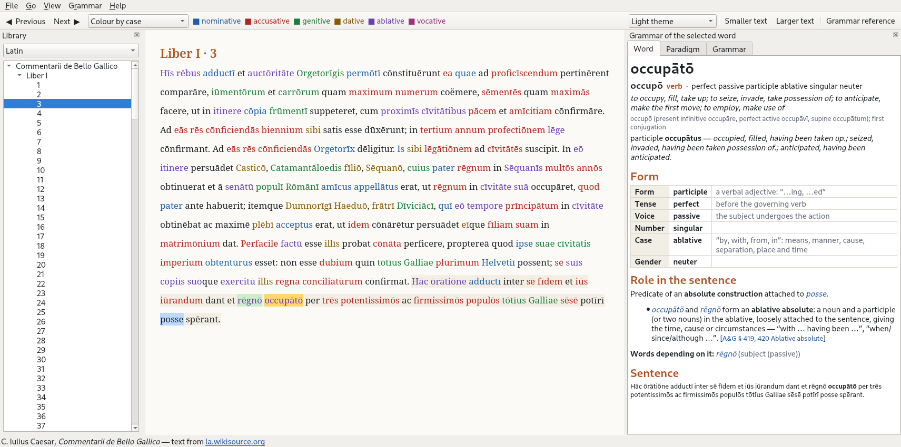
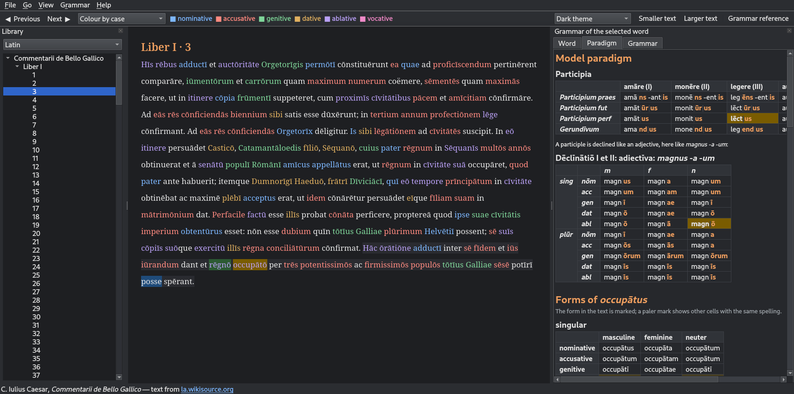

# Lang-Gram

A desktop reader that teaches grammar while you read. Open a classical text in
Latin, German, Czech or Polish, click any word, and the side panel shows

* **Word** – dictionary form and meaning, every grammatical category of the
  form (case, number, gender, tense, mood, voice …) with a one-line explanation,
  and the word's **role in the sentence**: what it depends on, what depends on
  it, and which construction it stands in (ablative absolute, accusative and
  infinitive, purpose clause, two-way preposition, genitive of negation …);
* **Paradigm** – the declension or conjugation type of the word (third
  declension i-stem, weak masculine noun, verb class IV …) with its key forms,
  then the complete inflection with the clicked form marked; for Latin also the
  model paradigm the word follows;
* **Grammar** – the grammar sections that explain the form and the
  construction: Allen & Greenough for Latin, Wikipedia's grammar tables for
  the other languages.





In the text the clicked word, the word it depends on and its own dependents are
highlighted in three colours. The text can also be coloured by part of speech
or by case.

## Running it

Python 3.9 or newer on Linux, Windows or macOS.

```bash
python -m venv .venv
```

```bash
.venv/bin/pip install -r requirements.txt
```

```bash
.venv/bin/python run.py
```

On Windows use `.venv\Scripts\pip` and `.venv\Scripts\python`. PyQt6 is the only
run-time dependency; all texts and grammar data are bundled in
`lang_gram/data` (about 6 MB) and the app never goes online.

| Keys | |
|---|---|
| click | analyse a word |
| ← / → | previous / next word |
| ↑ | jump to the word the current one depends on |
| Alt+← / Alt+→ | previous / next chapter |
| Ctrl++ / Ctrl+- | text size |
| theme box in the toolbar | System theme (follows the desktop's light/dark setting), Light, Dark |
| F2 | grammar reference window |

## What is in it

| Language | Text | Source |
|---|---|---|
| Latin | Caesar, *Commentarii de Bello Gallico*, books I–VIII (book I with macrons) | la.wikisource.org |
| Latin | Lhomond, *Epitome Historiae Sacrae* (1856 school edition, with its English chapter summaries) | la.wikisource.org |
| German | Grimm, *Kinder- und Hausmärchen* (1857): twelve tales | de.wikisource.org |
| Czech | K. J. Erben: *Zlatovláska*, *Tři zlaté vlasy Děda-Vševěda*, *Pták Ohnivák a liška Ryška* | cs.wikisource.org |
| Polish | Sienkiewicz *Bajka*, *Janko Muzykant*; Kraszewski *Kwiat paproci*; Prus *Katarynka* | pl.wikisource.org |

All reading texts come from Wikisource and nowhere else; the exact pages are
listed in `tools/fetch_texts.py` and linked in the status bar.

Grammar material:

* **Latin** – model paradigms of the declensions and conjugations are held as
  data in `lang_gram/latin_paradigms.py` (with stem|ending bars and macrons)
  and can be browsed in the reference window (F2). `fts.txt` (Allen and Greenough's
  *New Latin Grammar*, 1903) is cut into its numbered sections; about a hundred
  topics in `lang_gram/lang_la.py` link constructions to those sections.
* **German, Czech, Polish** – grammar tables from English Wikipedia
  (*German declension*, *German conjugation*, *Czech declension*,
  *Czech conjugation*, *Polish morphology* and others).
* **Every language** – the full paradigm and English glosses of each word come
  from English Wiktionary (via the kaikki.org machine-readable extract).

## How the analysis is made, and how far to trust it

Nothing is analysed at run time. `tools/` prepared the data once:

1. `fetch_texts.py` downloads the Wikisource pages and keeps the running text.
2. `annotate.py` sends the text to the UDPipe 2 service of Charles University
   (LatinPipe for Latin) for lemmas, morphology and a dependency tree. A
   normalised copy is parsed (macrons stripped, *-que* detached, *Thür → Tür*,
   *cœlum → caelum*), and the result is mapped back onto the original spelling.
3. `build_lexicon.py` collects the Wiktionary entries of all occurring forms.
4. `build_data.py` checks every word against the inflection tables: a lemma the
   dictionary does not know is replaced by the one whose table contains the
   form, and impossible features are corrected (Latin, German).
5. `build_grammar.py` and `build_reference.py` prepare the grammar texts.

The result is right most of the time, not always. Roughly 94 % of Latin and
96 % of German words are confirmed by the dictionary; Czech and Polish are a
little lower because Wiktionary covers them less fully. Typical mistakes: a
wrong attachment in a long Caesarian period, a homograph taken for the wrong
word (Czech *sní* read as “dreams” instead of “eats up”), a first dictionary
sense that does not fit the context. The notes on constructions are rules
applied to the parse, so they inherit its mistakes; where a rule cannot decide
it says “most often …” and lists the candidates. The Allen & Greenough text is
an OCR scan: most macrons are lost and tables are garbled, and 43 of its 642
sections run on from the preceding one.

## Rebuilding the data

```bash
.venv/bin/pip install -r requirements-build.txt
```

```bash
.venv/bin/python tools/build_all.py
```

The first run downloads about 310 MB of Wiktionary extracts and calls the
Wikisource, Wikipedia and UDPipe web services; everything is cached under
`build/`, which can be deleted at any time. To add a text, add an entry to
`WORKS` in `tools/fetch_texts.py` and run the script again.

## Tests

```bash
.venv/bin/python tests/test_app.py
```

(or `python -m pytest` if pytest is installed). The tests load every data file,
analyse sample words in all four languages and drive the window off-screen.

## Layout

```
run.py                 start the app
lang_gram/app.py       window, reader, panels, reference window
lang_gram/appearance.py  light / dark theme, following the desktop setting
lang_gram/theme.py     the colours of both themes
lang_gram/analysis.py  what the panel says about a word
lang_gram/paradigm.py  paradigm tables from dictionary entries
lang_gram/inflection.py  declension / conjugation type of a word, in words
lang_gram/latin_paradigms.py  Latin model paradigms as data
lang_gram/lang_*.py    language-specific rules and grammar links
lang_gram/morph.py     feature vocabulary shared with the tools
lang_gram/data/        bundled texts, lexicons, grammar
tools/                 scripts that build lang_gram/data
fts.txt                Allen & Greenough, source of the Latin grammar sections
```

## Sources and licences

* Reading texts: public-domain works transcribed by Wikisource contributors.
* Allen and Greenough's *New Latin Grammar* (1903): public domain.
* Grammar tables for German, Czech and Polish: English Wikipedia, CC BY-SA 4.0.
* Inflected forms and glosses: English Wiktionary, CC BY-SA 4.0, extracted by
  Wiktextract / kaikki.org.
* Morphological and syntactic annotation: UDPipe 2 and LatinPipe models
  (Institute of Formal and Applied Linguistics, Charles University), licensed
  CC BY-NC-SA 4.0 — the bundled annotations are for non-commercial use.
